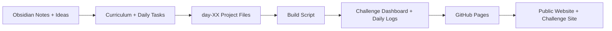
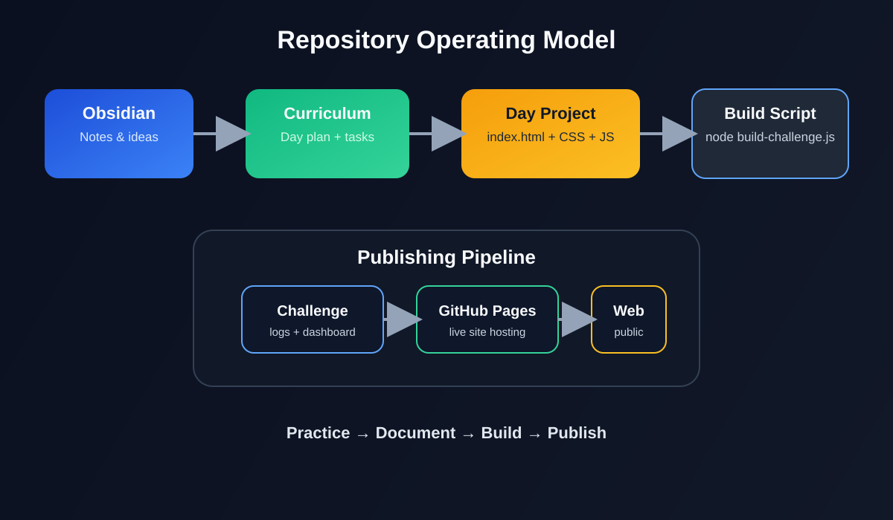
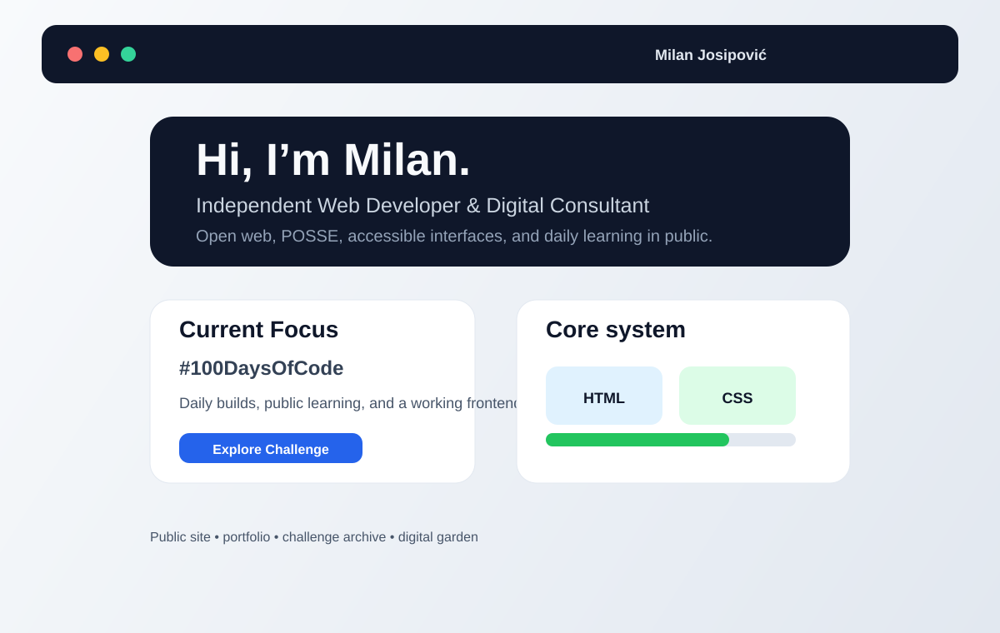
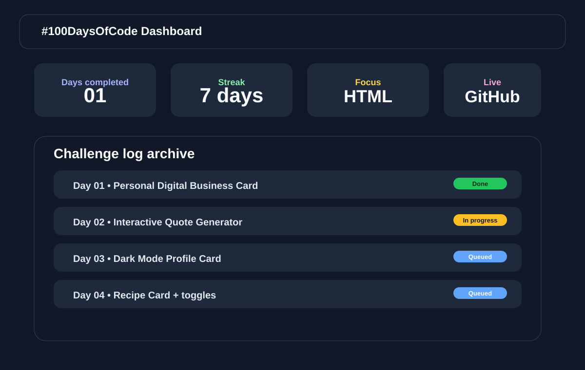

# Milan Josipović — Systems, Product, UX, and Digital Architecture

[](https://milanjosipovic.rs/)
[](https://milanjosipovic.rs/challenge/)
[](https://github.com/milanjosipovic)
[](https://indiewweb.org/)
[](https://obsidian.md/)
[](https://github.com/milanjosipovic)

Live project: https://milanjosipovic.rs/

Challenge dashboard: https://milanjosipovic.rs/challenge/

## Executive summary

I build digital systems that connect business logic, user experience, architecture, and implementation. My work is grounded in clarity, structure, and practical execution — not in abstract theory or passive learning.

This repository is the working foundation of that philosophy: a public system for learning, designing, building, writing, and shipping meaningful digital work.

It is not just a coding challenge archive. It is a practical portfolio and operating model for a future professional identity rooted in:

- business analysis and process architecture
- UX/UI design and user-centered design thinking
- system modeling and solution design
- full-stack implementation
- product clarity and responsible digital strategy
- public knowledge creation through essays, notes, and live learning

## Mission

To help businesses and people turn complexity into usable systems.

My mission is to combine strategy, design, architecture, and engineering into a single disciplined practice that creates better digital experiences, clearer workflows, and more human-centered products.

I want to build not just software, but systems that are understandable, useful, ethical, and durable.

## Why now / Why this matters

The digital world is full of fragmented tools, poor user flows, and disconnected systems. Many companies struggle not because they lack ideas, but because they lack clarity, structure, and a disciplined way to turn business intent into usable product reality.

This matters because:

- the best digital work starts with understanding the problem before writing code
- product clarity is often the difference between something useful and something expensive
- UX and architecture are not optional add-ons; they are strategic foundations
- AI can accelerate work only when paired with real systems thinking and disciplined execution
- public, transparent work builds trust and signals capability faster than hidden effort

This repository represents that approach in action.

## Who I am

Milan Josipović is a business-minded digital builder with a strong interest in systems thinking, digital product architecture, UX/UI design, and full-stack development.

I am developing a professional identity that sits at the center of four disciplines:

1. Business analysis and requirement modeling
2. Project and solution architecture
3. UX/UI design and product interaction thinking
4. Full-stack implementation across frontend, backend, and deployment

My core stack includes:

- HTML5, CSS3, JavaScript, ES6+
- Web Components
- Tailwind CSS
- TypeScript
- Node.js and TypeScript-based backend work
- SQL and data modeling
- DevOps and deployment workflows
- product thinking with a design-first lens

I am currently deepening my knowledge in:

- BI and reporting logic
- project architecture and solution design
- UX/UI systems and interaction design
- product strategy and digital transformation thinking

I also write essays for my digital garden and build long-form knowledge in public. That process matters because I believe in synthesis, reflection, and building personal systems for thinking clearly.

I have lived with OCD for more than 30 years, and I am committed to using my voice, work, and public presence to help reduce stigma and offer empathy to anyone struggling with mental health challenges. I intend to speak openly about OCD during my 100DaysOfCode live streams and leave those recordings on YouTube so others can learn from them and feel less alone.

## What I’m looking for

I am building a future that blends product thinking, architecture, user experience, and software delivery into a coherent professional model.

I am looking for:

- freelance and contract digital product work
- business analysis and solution design collaboration
- UX/UI design and frontend implementation projects
- project architecture and product systems consulting
- open-source and community-driven innovation work
- project engagement where clarity, quality, communication, and execution matter
- long-term collaboration with people who value thoughtful systems and human-centered design

This is not just about building features. It is about building better decisions, cleaner experiences, and more durable digital systems.

## Stack & workflow

My work is grounded in practical, modern tooling and disciplined delivery:

- HTML5 and semantic document structure
- CSS and design systems
- JavaScript and ES6+ production patterns
- Web Components for reusable UI architecture
- Tailwind CSS for rapid, design-consistent UI implementation
- TypeScript for safer and more scalable app logic
- Node.js / TypeScript for backend and service layers
- SQL for structured data understanding and system design
- DevOps thinking for deployment, automation, and reliability
- AI tools used as structured thinking partners and productivity accelerators

Core workflow:

Observe → Model → Design → Build → Validate → Publish → Improve

## Repository purpose

This repository is the operational foundation for a future digital brand, learning system, and professional practice built around clarity, craft, and systems thinking.

It supports:

- business analysis and structured problem framing
- UX/UI exploration and interaction design experiments
- frontend and full-stack implementation work
- project architecture and solution mapping
- knowledge capture through digital essays and reflective writing
- public learning through 100DaysOfCode practice and live streams
- open-source value creation and a transparent work process
- a durable personal brand rooted in trust, capability, and craftsmanship

This repository is not separate from my professional identity. It is one of the clearest expressions of it.

## Project structure

- [CURRICULUM.md](CURRICULUM.md) — the 100-day roadmap and skill progression
- [CONCEPTS_MAP.md](CONCEPTS_MAP.md) — the technical concepts assigned to each day
- [WORKFLOW.md](WORKFLOW.md) — the implementation, production, and publishing process
- [day-01](day-01) — the active challenge folder for daily execution
- [challenge](challenge) — generated dashboard, logs, and published outputs
- [assets](assets) — shared style and visual resources
- [build-challenge.js](build-challenge.js) — automated build and publishing pipeline
- [index.html](index.html) — the public project entry and personal web hub
- [LICENSE](LICENSE) — project licensing information

## Daily challenge system

Each challenge follows a repeatable structure:

```text
day-XX/
├── index.html
├── styles.css
├── script.js
├── README.md
```

This workflow reinforces:

- semantic HTML structure and clean markup
- modern CSS design and layout discipline
- JavaScript and ES6+ interaction patterns
- UI thinking through real product scenarios
- product-focused implementation and validation

## Learning model

I learn by building, measuring, and publishing.

The model is:

1. Choose a real challenge or problem
2. Understand the system and constraints
3. Design the user flow and technical approach
4. Build the implementation
5. Validate the quality and usability
6. Document the reasoning
7. Publish the work and improve from real feedback

The build command used for generated outputs is:

```bash
node build-challenge.js
```

## Repo flow diagram

This diagram explains how the repository operates as a systems-based learning and publishing pipeline.





## Screenshots

A few visual references for the live project ecosystem.

### Homepage mockup



### Challenge dashboard mockup



## Live deployment

This project is publicly available through the live site and challenge pages:

- Website: https://milanjosipovic.rs/
- Challenge dashboard: https://milanjosipovic.rs/challenge/
- Daily logs: https://milanjosipovic.rs/challenge/logs/

## Long-term value

This repository is a visible system for:

- building durable engineering discipline
- converting learning into public product output
- strengthening business and technical decision-making
- developing real-world UX and product judgment
- creating trust through transparency and consistency
- building a personal brand rooted in value, clarity, and execution

## Status

This workspace is an active professional practice environment for systems thinking, UX/UI exploration, frontend architecture, and public learning.

## License

This project is released under the MIT License. See [LICENSE](LICENSE) for full details.

---

Built for clarity, craft, systems thinking, and meaningful digital work.

## Project structure

- [CURRICULUM.md](CURRICULUM.md) — the full 100-day roadmap and tiered difficulty progression
- [CONCEPTS_MAP.md](CONCEPTS_MAP.md) — the tech concepts assigned to each day
- [WORKFLOW.md](WORKFLOW.md) — the implementation, logging, and deployment process
- [day-01](day-01) — the current daily challenge workspace
- [challenge](challenge) — generated dashboard and published daily logs
- [assets](assets) — shared visual assets and styling resources
- [build-challenge.js](build-challenge.js) — automation for challenge dashboard generation
- [index.html](index.html) — entry page and project hub
- [LICENSE](LICENSE) — repository licensing information

## Daily challenge system

Each challenge follows a repeatable structure:

```text
day-XX/
├── index.html
├── styles.css
├── script.js
├── README.md
```

The daily workflow reinforces:

- semantic HTML structure
- CSS layout and visual design
- JavaScript interactivity and state logic
- real product thinking
- buildable, testable frontend patterns

## Learning model

This system is built around action over passivity:

1. Choose a challenge from the curriculum
2. Study the required concept and constraints
3. Implement the UI in code
4. Validate the result in the browser
5. Record the learning and reflection
6. Publish the work and repeat consistently

The build command used for generated outputs is:

```bash
node build-challenge.js
```

## Repo flow diagram

This diagram explains how the repository works as a learning and publishing system:


## Screenshots

A few visual references for the live project experience:

### Homepage mockup


### Challenge dashboard mockup


## Live deployment

This project is publicly available through the site and challenge pages:

- Website: https://milanjosipovic.rs/
- Challenge dashboard: https://milanjosipovic.rs/challenge/
- Daily logs: https://milanjosipovic.rs/challenge/logs/

## Long-term value

This repository is not a disposable exercise set. It is a visible system for:

- improving frontend fundamentals through repetition
- proving capability through actual output
- building a public digital identity and portfolio
- combining AI with human learning in a structured way
- creating a sustainable workflow for long-term development practice

## Status

This workspace is an active challenge environment for the #100DaysOfCode initiative and ongoing frontend learning practice.

## License

This project is released under the MIT License. See [LICENSE](LICENSE) for full details.

---

Built for consistent execution, public learning, and open web craftsmanship.
